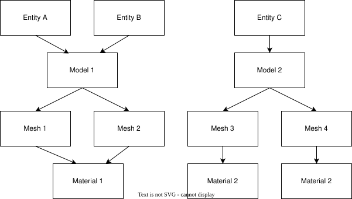
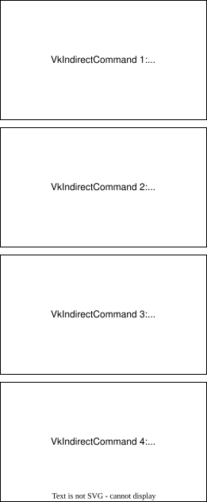
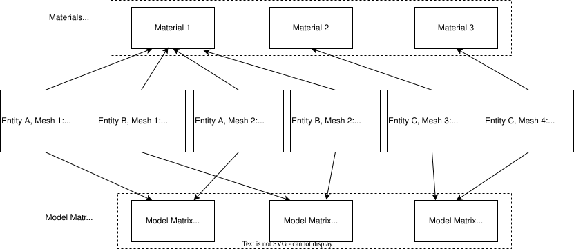

# Indirect Drawing

Up until this chapter, we have rendered the models by submitting one draw command for each of the meshes they are composed of. In this chapter,
we will start moving towards a more efficient way of rendering. This type of rendering does not receive a bunch of draw commands to draw the
scene, instead it relies on indirect drawing commands. Indirect draw commands are, in essence, draw commands stored in a buffer that
obtain the parameters required to perform the operation from a set of global buffers. This is a more efficient way of drawing because:

- We need just to record a single draw call.
- We can perform in-GPU operations, such as culling, that will operate over the buffer that stores the drawing parameters through compute
shaders, reducing the load on the CPU side.

As you can see, the ultimate goal is to maximize the utilization of the GPU while removing potential bottlenecks that may occur at the CPU
side and latencies due to CPU to GPU communications.

You can find the complete source code for this chapter [here](../../booksamples/chapter-19).

## Overview

As it has been introduced, we will use a buffer to store indirect drawing commands to render a scene with a single draw call. Basically,
we will store in a buffer `DrawIndirectCommand` structures, which will contain information that will allow us to refer to the different
buffers that will hold vertex information, the indices, materials and per instance data (such as model matrices, etc.). The
`DrawIndirectCommand` is defined by the following fields:

- `vertex_count`: Number of vertices to be drawn.
- `instance_count`: Number of instances to be drawn. If we have several entities that share the same model, we do not need to record an
individual draw call for each of the entities and all the associated meshes. We can just use one command to draw a mesh for all the associated
entities. We just need to set up the number of entities with this field.
- `first_vertex`: The index of the first vertex to be drawn.
- `first_instance`: It can be used to set up a unique instance identifier to be used when drawing. We will see in the shaders how we can use
it.

It is important to note that we will not be recording calls to draw indirect commands. Instead, we will store them in a buffer and trigger
the drawing by performing a single
call to the `vkCmdDrawIndirect` function. This requires us to restructure the code, and use additional buffers to properly refer to the data
we will need.

In order to understand how we will use `DrawIndirectCommand`s, let's imagine we have the following structure (to simplify we will not use
animated models):



We will have three entities. The first two share the same model which has two meshes, while the third one has a model which is not shared
by another entity and also has two meshes. We will need to record the following `DrawIndirectCommand`s:



With animated models it is not so simple to use instance render, since the entities, even if they share the same model, can be in a different
animation state and therefore will use specific vertex buffers that will hold the result of the animation.

We will create a buffer that will contain as many entries as entities and will hold the model matrices associated to each entity. In
addition, in order to properly access the entity and per mesh data, we will create a specific buffer that will have as many entries as the
number of entities multiplied by the number of meshes associated to them. Each entry in that buffer will contain:

- The index in the buffer that holds the model matrices associated to the entity.
- The material index (in previous chapters, since we recorded a draw call for each mesh and entity, we used push constants for that; now, we
cannot use that approach since we will submit a single draw call.)
- The address of the vertex buffer associated to the mesh.
- The address of the index buffer associated to the mesh.

The following figure shows the structures involved.



## Initial changes

We need to enable two features in the `VkDevice` struct:

- `multi_draw_indirect`: Since we will be using the draw indirect capability.
- `draw_indirect_first_instance`: When using draw indirect, we need to set up a proper instance ID for each of the involved draw calls,
which we will later use in the shaders to access the per-instance data.

Changes in the `VkDevice` struct are like this:

**File: src/eng/vk/vkDevice.zig**
```zig
pub const VkDevice = struct {
    ...
    pub fn create(allocator: std.mem.Allocator, vkInstance: vk.inst.VkInstance, vkPhysDevice: vk.phys.VkPhysDevice) !VkDevice {
        ...
        const features = vulkan.PhysicalDeviceFeatures{
            .draw_indirect_first_instance = vulkan.Bool32.true,
            .multi_draw_indirect = vulkan.Bool32.true,
            ...
        };
        ...
    }
    ...
};
```

We will need to organize our entities by the models to which they are associated; we will create a `StringHashMap` which will store, per
model identifier, the list of entities associated to that model. Therefore, we need to modify the `Scene` struct like this:

**File: src/eng/scene.zig**
```zig
pub const Scene = struct {
    ...
    entitiesMap: std.StringHashMap(std.ArrayList(*eng.ent.Entity)),
    ...
    pub fn addEntity(self: *Scene, allocator: std.mem.Allocator, entity: *eng.ent.Entity) !void {
        if (self.entitiesMap.getPtr(entity.modelId)) |list| {
            try list.append(allocator, entity);
        } else {
            var list = try std.ArrayList(*eng.ent.Entity).initCapacity(allocator, 1);
            try list.append(allocator, entity);
            const key = try allocator.dupe(u8, entity.modelId);
            try self.entitiesMap.put(key, list);
        }
    }
    ...
    pub fn create(allocator: std.mem.Allocator) !Scene {
        ...
        const entitiesMap = std.StringHashMap(std.ArrayList(*eng.ent.Entity)).init(allocator);
        ...
    }

    pub fn cleanup(self: *Scene, allocator: std.mem.Allocator) void {
        var iter = self.entitiesMap.iterator();
        while (iter.next()) |entry| {
            for (entry.value_ptr.items) |entity| {
                entity.cleanup(allocator);
            }
            entry.value_ptr.deinit(allocator);
            allocator.free(entry.key_ptr.*);
        }
        ...
    }
};
```

This change means that we need to update the `AnimsCache` struct since we need to traverse through the entities in a different way:

**File: src/eng/animsCache.zig**
```zig
pub const AnimsCache = struct {
    ...
    pub fn init(
        self: *AnimsCache,
        allocator: std.mem.Allocator,
        vkCtx: *const vk.ctx.VkCtx,
        engCtx: *const eng.engine.EngCtx,
        modelsCache: *const eng.mcach.ModelsCache,
    ) !void {
        var iter = engCtx.scene.entitiesMap.valueIterator();
        while (iter.next()) |listRef| {
            for (listRef.items) |entity| {
                const vulkanModel = modelsCache.modelsMap.get(entity.modelId);
                if (!vulkanModel.?.hasAnimations()) {
                    continue;
                }

                var bufferMap: std.StringArrayHashMapUnmanaged(vk.buf.VkBuffer) = .empty;
                errdefer {
                    var it = bufferMap.iterator();
                    while (it.next()) |entry| {
                        entry.value_ptr.cleanup(vkCtx);
                    }
                    bufferMap.deinit(allocator);
                }
                for (vulkanModel.?.meshes.items) |vulkanMesh| {
                    const animBuffer = try vk.buf.VkBuffer.create(
                        vkCtx,
                        vulkanMesh.buffVtx.size,
                        .{ .vertex_buffer = true, .storage_buffer = true, .shader_device_address = true },
                        @backingInt(vk.vma.VmaFlags.None),
                        vk.vma.VmaUsage.VmaUsageAuto,
                        vk.vma.VmaMemoryFlags.None,
                    );
                    try bufferMap.put(allocator, vulkanMesh.id, animBuffer);
                }

                try self.entitiesAnimBuffers.put(allocator, try allocator.dupe(u8, entity.id), bufferMap);
            }
        }
    }
};
```

We will create a new struct named `GlobalBuffers` that will hold some of the buffers described in the introduction and which starts like
this:

**File: src/eng/modelsCache.zig**
```zig
pub const IND_COMMAND_STRIDE: u32 = @sizeOf(vulkan.DrawIndirectCommand);
const DEFAULT_NUM_COMMANDS: u32 = 100;
const instanceData_SIZE: u32 = @sizeOf(u32) * 2 + @sizeOf(u64) * 2;

pub const GlobalBuffers = struct {
    buffIndirectDrawCmds: [com.common.FRAMES_IN_FLIGHT]vk.buf.VkBuffer,
    buffInstanceData: [com.common.FRAMES_IN_FLIGHT]vk.buf.VkBuffer,
    buffModelMatrices: [com.common.FRAMES_IN_FLIGHT]vk.buf.VkBuffer,
    drawCounts: [com.common.FRAMES_IN_FLIGHT]u32,

    pub fn cleanup(self: *GlobalBuffers, vkCtx: *const vk.ctx.VkCtx) void {
        for (&self.buffIndirectDrawCmds) |buff| {
            buff.cleanup(vkCtx);
        }
        for (&self.buffInstanceData) |buff| {
            buff.cleanup(vkCtx);
        }
        for (&self.buffModelMatrices) |buff| {
            buff.cleanup(vkCtx);
        }
    }
    ...
};
```

The buffers that we will use are:
- `buffIndirectDrawCmds`: This will hold the draw indirect commands.
- `buffInstanceData`: This will hold instance data (model matrix index, material index and the addresses for the vertex and index buffers).
- `buffModelMatrices`: This will hold model matrices for the entities.

You may have noticed that we use arrays of buffers; we will have separate buffer instances per frame in flight. We then can update the
contents of the buffers associated to the current frame while the ones associated to a previous frame, which may still be in use, can be safely
accessed by the GPU. We will be upsizing the buffers whenever we need more space. We will never shrink the buffers if the data to
be used requires less space to avoid buffer recreation calls. This is why we need to keep track of the number of indirect command buffers
to be submitted, which is stored, per frame in flight, in the `drawCounts` array. We simply cannot use the size of the buffers stored in
`buffIndirectDrawCmds`, since their size may be higher than the actual number of commands to be drawn.

The `create` function is defined like this:

**File: src/eng/modelsCache.zig**
```zig
pub const GlobalBuffers = struct {
    ...
    pub fn create(vkCtx: *vk.ctx.VkCtx) !GlobalBuffers {
        var buffIndirectDrawCmds: [com.common.FRAMES_IN_FLIGHT]vk.buf.VkBuffer = undefined;
        for (0..com.common.FRAMES_IN_FLIGHT) |i| {
            buffIndirectDrawCmds[i] = try vk.buf.VkBuffer.create(
                vkCtx,
                @as(u64, IND_COMMAND_STRIDE) * @as(u64, DEFAULT_NUM_COMMANDS),
                .{ .indirect_buffer = true, .storage_buffer = true },
                @backingInt(vk.vma.VmaFlags.VmaAllocationCreateHostAccessSequentialWriteBit),
                vk.vma.VmaUsage.VmaUsageAuto,
                vk.vma.VmaMemoryFlags.MemoryPropertyHostVisibleBitAndCoherent,
            );
        }

        var buffInstanceData: [com.common.FRAMES_IN_FLIGHT]vk.buf.VkBuffer = undefined;
        for (0..com.common.FRAMES_IN_FLIGHT) |i| {
            buffInstanceData[i] = try vk.buf.VkBuffer.create(
                vkCtx,
                @as(u64, DEFAULT_NUM_COMMANDS) * @as(u64, instanceData_SIZE),
                .{ .shader_device_address = true },
                @backingInt(vk.vma.VmaFlags.VmaAllocationCreateHostAccessSequentialWriteBit),
                vk.vma.VmaUsage.VmaUsageAuto,
                vk.vma.VmaMemoryFlags.MemoryPropertyHostVisibleBitAndCoherent,
            );
        }

        var buffModelMatrices: [com.common.FRAMES_IN_FLIGHT]vk.buf.VkBuffer = undefined;
        for (0..com.common.FRAMES_IN_FLIGHT) |i| {
            buffModelMatrices[i] = try vk.buf.VkBuffer.create(
                vkCtx,
                @as(u64, DEFAULT_NUM_COMMANDS) * @as(u64, @sizeOf(zm.Mat)),
                .{ .shader_device_address = true },
                @backingInt(vk.vma.VmaFlags.VmaAllocationCreateHostAccessSequentialWriteBit),
                vk.vma.VmaUsage.VmaUsageAuto,
                vk.vma.VmaMemoryFlags.MemoryPropertyHostVisibleBitAndCoherent,
            );
        }

        const drawCounts: [com.common.FRAMES_IN_FLIGHT]u32 = @splat(0);

        return .{
            .buffIndirectDrawCmds = buffIndirectDrawCmds,
            .buffInstanceData = buffInstanceData,
            .buffModelMatrices = buffModelMatrices,
            .drawCounts = drawCounts,
        };
    }
    ...
};
```

It instantiates all the buffers with default values. We will need a function named `createOrUpdateBuffers` to resize the buffers if we need
more space:

**File: src/eng/modelsCache.zig**
```zig
pub const GlobalBuffers = struct {
    ...
    fn createOrUpdateBuffers(
        self: *GlobalBuffers,
        vkCtx: *const vk.ctx.VkCtx,
        frame: usize,
        numIndCommands: u32,
        numInstanceData: u32,
        numEntities: u32,
    ) !void {
        const indCommandsSize: u64 =
            @as(u64, IND_COMMAND_STRIDE) * @as(u64, numIndCommands);

        if (self.buffIndirectDrawCmds[frame].size < indCommandsSize) {
            self.buffIndirectDrawCmds[frame].cleanup(vkCtx);
            self.buffIndirectDrawCmds[frame] = try vk.buf.VkBuffer.create(
                vkCtx,
                indCommandsSize,
                .{ .indirect_buffer = true, .storage_buffer = true },
                @backingInt(vk.vma.VmaFlags.VmaAllocationCreateHostAccessSequentialWriteBit),
                vk.vma.VmaUsage.VmaUsageAuto,
                vk.vma.VmaMemoryFlags.MemoryPropertyHostVisibleBitAndCoherent,
            );
        }
        self.drawCounts[frame] = numIndCommands;

        const instanceDataSize: u64 =
            @as(u64, numInstanceData) * @as(u64, instanceData_SIZE);

        if (self.buffInstanceData[frame].size < instanceDataSize) {
            self.buffInstanceData[frame].cleanup(vkCtx);
            self.buffInstanceData[frame] = try vk.buf.VkBuffer.create(
                vkCtx,
                instanceDataSize,
                .{ .storage_buffer = true, .shader_device_address = true },
                @backingInt(vk.vma.VmaFlags.VmaAllocationCreateHostAccessSequentialWriteBit),
                vk.vma.VmaUsage.VmaUsageAuto,
                vk.vma.VmaMemoryFlags.MemoryPropertyHostVisibleBitAndCoherent,
            );
        }

        const modelMatricesSize: u64 =
            @as(u64, numEntities) * @as(u64, @sizeOf(zm.Mat));

        if (self.buffModelMatrices[frame].size < modelMatricesSize) {
            self.buffModelMatrices[frame].cleanup(vkCtx);
            self.buffModelMatrices[frame] = try vk.buf.VkBuffer.create(
                vkCtx,
                modelMatricesSize,
                .{ .storage_buffer = true, .shader_device_address = true },
                @backingInt(vk.vma.VmaFlags.VmaAllocationCreateHostAccessSequentialWriteBit),
                vk.vma.VmaUsage.VmaUsageAuto,
                vk.vma.VmaMemoryFlags.MemoryPropertyHostVisibleBitAndCoherent,
            );
        }
    }
    ...
};
```

We will provide some *getters* to access the buffers and the draw count for the current frame:

**File: src/eng/modelsCache.zig**
```zig
pub const IND_COMMAND_STRIDE: u32 = @sizeOf(vulkan.DrawIndirectCommand);
const DEFAULT_NUM_COMMANDS: u32 = 100;
const instanceData_SIZE: u32 = @sizeOf(u32) * 2 + @sizeOf(u64) * 2;

pub const GlobalBuffers = struct {
    ...
    pub fn getAddrBufInstanceData(self: *const GlobalBuffers, frameIdx: usize) u64 {
        return self.buffInstanceData[frameIdx].address orelse 0;
    }

    pub fn getAddrBufModelMatrices(self: *const GlobalBuffers, frameIdx: usize) u64 {
        return self.buffModelMatrices[frameIdx].address orelse 0;
    }

    pub fn getDrawCount(self: *const GlobalBuffers, frameIdx: usize) u32 {
        return self.drawCounts[frameIdx];
    }

    pub fn getIndirectBuffer(self: *const GlobalBuffers, frameIdx: usize) *const vk.buf.VkBuffer {
        return &self.buffIndirectDrawCmds[frameIdx];
    }
    ...
};
```

Prior to rendering each frame, we need to populate the buffers by calling the `update` function which is defined like this:

**File: src/eng/modelsCache.zig**
```zig
pub const GlobalBuffers = struct {
    ...
    pub fn update(
        self: *GlobalBuffers,
        allocator: std.mem.Allocator,
        vkCtx: *const vk.ctx.VkCtx,
        scene: *eng.scn.Scene,
        modelsCache: *ModelsCache,
        animsCache: *eng.acach.AnimsCache,
        materialsCache: *MaterialsCache,
        frame: usize,
    ) !void {
        var arenaAlloc = std.heap.ArenaAllocator.init(allocator);
        defer arenaAlloc.deinit();
        const arena = arenaAlloc.allocator();

        var indCommandList: std.ArrayListUnmanaged(vulkan.DrawIndirectCommand) = .empty;

        var baseEntityIdx: u32 = 0;
        var numInstanceData: u32 = 0;
        var totalEntities: u32 = 0;

        var it = scene.entitiesMap.iterator();
        while (it.next()) |entry| {
            const key = entry.key_ptr.*;
            const entities = entry.value_ptr.*;
            const numEntities: u32 = @intCast(entities.items.len);
            totalEntities += numEntities;

            const vulkanModel = modelsCache.modelsMap.get(key) orelse {
                log.warn("Model not found: {s}", .{key});
                continue;
            };
            const vulkanMeshList = vulkanModel.meshes.items;
            const numMeshes: u32 = @intCast(vulkanMeshList.len);

            if (vulkanModel.hasAnimations()) {
                var i: u32 = 0;
                while (i < numMeshes) : (i += 1) {
                    var j: u32 = 0;
                    while (j < numEntities) : (j += 1) {
                        const vulkanMesh = vulkanMeshList[i];
                        try indCommandList.append(arena, .{
                            .vertex_count = @intCast(vulkanMesh.numIndices),
                            .instance_count = 1,
                            .first_vertex = 0,
                            .first_instance = baseEntityIdx,
                        });
                        baseEntityIdx += 1;
                        numInstanceData += 1;
                    }
                }
            } else {
                var j: u32 = 0;
                while (j < numMeshes) : (j += 1) {
                    const vulkanMesh = vulkanMeshList[j];
                    try indCommandList.append(arena, .{
                        .vertex_count = @intCast(vulkanMesh.numIndices),
                        .instance_count = numEntities,
                        .first_vertex = 0,
                        .first_instance = baseEntityIdx,
                    });
                    baseEntityIdx += numEntities;
                    numInstanceData += numEntities;
                }
            }
        }

        try self.createOrUpdateBuffers(
            vkCtx,
            frame,
            @intCast(indCommandList.items.len),
            numInstanceData,
            totalEntities,
        );

        try self.updateCmdIndirectCommands(vkCtx, indCommandList.items, frame);
        try self.updateInstanceData(vkCtx, scene, modelsCache, materialsCache, animsCache, frame);
    }
    ...
};
```

Let's dissect the function:
- We first iterate over the models and their associated entities.
- We get the meshes associated to the model.
- If the model is animated, we need to create an indirect command for each of the entities and meshes; no instanced render will be used.
This is why we create in this case the command with `instance_count` equal to `1`. We need to properly set the `first_instance` value.
In this case, for animated entities, for each mesh of the entity we just increase the value by one. Later on, in the shaders we will use the
built-in variable `gl_InstanceIndex`, which will help us to navigate through the `buffInstanceData` data buffer. For each mesh that we
process for each entity of an animated model, `gl_InstanceIndex` will be equal to the value set in the `first_instance` field.
- For non animated models, we will just create one `DrawIndirectCommand` per mesh, setting the `instance_count` to the number of entities
associated to the model. In this case we increment the `first_instance` field by the number of entities. Imagine we are processing `Mesh 1`
from the examples described above. We will create just one `DrawIndirectCommand` structure, setting the `instance_count` field to `2`
(since `Entity A` and `Entity B` are associated to the same model). When processing the vertices of `Mesh 1` for `Entity A`, which we
assume will be the first instance, the `gl_InstanceIndex` will have the value of the `first_instance` field, that is `0`. When processing
the vertices of `Mesh 1` for `Entity B`, which we assume will be the second instance, `gl_InstanceIndex` will have the value of the
`first_instance` field plus `1`, that is `1`. Now, for `Mesh 2`, when we create the `DrawIndirectCommand` we will set up the
`first_instance` field to `2`. When processing the vertices of `Mesh 2` for `Entity A` the `gl_InstanceIndex` will have the value of the
`first_instance` field, that is `2`. When processing the vertices of `Mesh 2` for `Entity B` `gl_InstanceIndex` will have the value of the
`first_instance` field plus `1`, that is `3`. You can see how this goes.
- After we have properly created the list of `DrawIndirectCommand` structures, we call the `createOrUpdateBuffers` function to properly
size the buffers and after that we call the `updateCmdIndirectCommands` function to dump the list of `DrawIndirectCommand` structures into
the proper buffer and the `updateInstanceData` to populate the `buffInstanceData` and the `buffModelMatrices` buffers.

The `updateCmdIndirectCommands` function is defined like this:

**File: src/eng/modelsCache.zig**
```zig
pub const GlobalBuffers = struct {
    ...
    fn updateCmdIndirectCommands(
        self: *GlobalBuffers,
        vkCtx: *const vk.ctx.VkCtx,
        indCommandList: []const vulkan.DrawIndirectCommand,
        frame: usize,
    ) !void {
        const buffer = &self.buffIndirectDrawCmds[frame];
        const mapped = (try buffer.map(vkCtx)).?;
        const dst: [*]vulkan.DrawIndirectCommand = @ptrCast(@alignCast(mapped));

        for (indCommandList, 0..) |cmd, i| {
            dst[i] = cmd;
        }

        buffer.unMap(vkCtx);
    }
    ...
};
```

We just dump in the `buffIndirectDrawCmds` the `DrawIndirectCommand` structures passed as a list for the current frame.

The `updateInstanceData` function is defined like this:

**File: src/eng/modelsCache.zig**
```zig
pub const GlobalBuffers = struct {
    ...
    fn updateInstanceData(
        self: *GlobalBuffers,
        vkCtx: *const vk.ctx.VkCtx,
        scene: *eng.scn.Scene,
        modelsCache: *ModelsCache,
        materialsCache: *MaterialsCache,
        animsCache: *eng.acach.AnimsCache,
        frame: usize,
    ) !void {
        var bufferInstances = &self.buffInstanceData[frame];
        const instanceData: [*]u8 = @ptrCast((try bufferInstances.map(vkCtx)).?);

        var bufferModels = &self.buffModelMatrices[frame];
        const matricesData: [*]u8 = @ptrCast((try bufferModels.map(vkCtx)).?);

        var baseEntities: u32 = 0;
        var offset: usize = 0;

        var it = scene.entitiesMap.iterator();
        while (it.next()) |entry| {
            const modelId = entry.key_ptr.*;
            const entities = entry.value_ptr.*;
            const numEntities: u32 = @intCast(entities.items.len);

            const vulkanModel = modelsCache.modelsMap.get(modelId) orelse {
                log.warn("Model not found: {s}", .{modelId});
                continue;
            };
            const animatedModel = vulkanModel.hasAnimations();
            const vulkanMeshList = vulkanModel.meshes.items;
            const numMeshes: u32 = @intCast(vulkanMeshList.len);

            var i: u32 = 0;
            while (i < numMeshes) : (i += 1) {
                const mesh = vulkanMeshList[i];
                var vtxBufferAddress: u64 = mesh.buffVtx.address.?;
                const idxBufferAddress: u64 = mesh.buffIdx.address.?;

                var j: u32 = 0;
                while (j < numEntities) : (j += 1) {
                    const entity = entities.items[j];
                    const entityIdx = baseEntities + j;

                    const modelMatrix = zm.matToArr(entity.modelMatrix);
                    const matrixBytes: []const u8 = std.mem.asBytes(&modelMatrix);
                    const matrixOffset = @as(usize, entityIdx) * @sizeOf(zm.Mat);
                    const matrixDst = matricesData + matrixOffset;
                    @memcpy(matrixDst[0..matrixBytes.len], matrixBytes);

                    std.mem.writeInt(u32, instanceData[offset..][0..4], entityIdx, .little);
                    offset += @sizeOf(u32);

                    const materialIdx: u32 = @intCast(
                        materialsCache.materialsMap.getIndex(mesh.materialId) orelse 0,
                    );
                    std.mem.writeInt(u32, instanceData[offset..][0..4], materialIdx, .little);
                    offset += @sizeOf(u32);

                    if (animatedModel) {
                        vtxBufferAddress = animsCache.getBuffer(entity.id, mesh.id).?.address.?;
                    }
                    std.mem.writeInt(u64, instanceData[offset..][0..8], vtxBufferAddress, .little);
                    offset += @sizeOf(u64);

                    std.mem.writeInt(u64, instanceData[offset..][0..8], idxBufferAddress, .little);
                    offset += @sizeOf(u64);
                }
            }
            baseEntities += numEntities;
        }

        bufferInstances.unMap(vkCtx);
        bufferModels.unMap(vkCtx);
    }
};
```

We iterate again over the models and the entities. For each of the entities we just dump the model matrix in the `buffModelMatrices`. For each
of the meshes and entities we also populate the structure stored in the `buffInstanceData` buffer which contains the index to access the model
matrix, the material index and the addresses of the buffers that hold vertex and index data. In the case of animated models, we need to
take care of selecting the proper vertex buffer that will hold the results of applying the animation over the animation pose.

## Scene render changes

In order to properly understand why we are doing the changes in this way, we will see now how we use all of these structures when
rendering the scene. We will see first the changes in the scene vertex shader (`scn_vtx.glsl`):

**File: res/shaders/scn_vtx.glsl**
```glsl
#version 450
#extension GL_EXT_buffer_reference: require
#extension GL_EXT_buffer_reference2: enable
#extension GL_EXT_scalar_block_layout: require

layout(location = 0) out vec4 outPos;
layout(location = 1) out vec2 outTextCoords;
layout(location = 2) out vec3 outNormal;
layout(location = 3) out vec3 outTangent;
layout(location = 4) out vec3 outBitangent;
layout(location = 5) flat out uint outMaterialIdx;

layout(set = 0, binding = 0) uniform CamUniform {
    mat4 projMatrix;
    mat4 viewMatrix;
} camUniform;

struct Vertex {
    vec3 inPos;
    vec2 inTextCoords;
    vec3 inNormal;
    vec3 inTangent;
    vec3 inBitangent;
};

layout(scalar, buffer_reference) buffer VertexBuffer {
    Vertex[] vertices;
};

layout(std430, buffer_reference) buffer IndexBuffer {
    uint[] indices;
};

struct InstanceData {
    uint modelMatrixIdx;
    uint materialIdx;
    VertexBuffer vertexBuffer;
    IndexBuffer indexBuffer;
};

layout(std430, buffer_reference, buffer_reference_align=16) buffer InstancesDataBuffer {
    InstanceData[] instancesData;
};

layout(std430, buffer_reference, buffer_reference_align=8) buffer ModelMatricesDataBuffer {
    mat4[] modelMatrices;
};

layout(push_constant) uniform pc {
    InstancesDataBuffer instancesDataBuffer;
    ModelMatricesDataBuffer modelsMatricesDataBuffer;
} push_constants;

void main()
{
    uint entityId = gl_InstanceIndex;

    InstancesDataBuffer instancesDataBuffer = push_constants.instancesDataBuffer;
    InstanceData instanceData = instancesDataBuffer.instancesData[entityId];

    ModelMatricesDataBuffer modelMatricesDataBuffer = push_constants.modelsMatricesDataBuffer;
    mat4 modelMatrix = modelMatricesDataBuffer.modelMatrices[instanceData.modelMatrixIdx];

    VertexBuffer vertexBuffer = instanceData.vertexBuffer;
    IndexBuffer indexBuffer = instanceData.indexBuffer;

    uint index = indexBuffer.indices[gl_VertexIndex];
    Vertex vertex = vertexBuffer.vertices[index];

    vec3 inPos    = vertex.inPos;
    vec4 worldPos = modelMatrix * vec4(inPos, 1);
    mat3 mNormal  = transpose(inverse(mat3(modelMatrix)));

    outPos         = worldPos;
    outTextCoords  = vertex.inTextCoords;
    outNormal      = normalize(mNormal * vertex.inNormal);
    outTangent     = normalize(mNormal * vertex.inTangent);
    outBitangent   = normalize(mNormal * vertex.inBitangent);
    outMaterialIdx = instanceData.materialIdx;

    gl_Position    = camUniform.projMatrix * camUniform.viewMatrix * worldPos;
}
```

First we need to pass the material index to the fragment shader as an output variable (`outMaterialIdx`), since it will not be available
through push constants. We use the `flat` modifier since we do not want to perform any kind of interpolation. Push constants now just define
addresses for the instances buffer (the one we defined in the `GlobalBuffers` struct as `buffInstanceData`) and the buffer that holds model
matrices. The `InstancesDataBuffer` just defines the data explained above, the model matrix index, the material index and the addresses of
the vertices and indices buffers. In order to access the proper element in that buffer, we just use the `gl_InstanceIndex` built-in variable
as explained previously. The rest of the code is quite similar, once we get the proper references, we process the vertices in the same way.
We need only to pass the material index to be used in the fragment shader, which only needs to be changed a little to retrieve that
value from input parameters instead of through a push constant:

**File: res/shaders/scn_frg.glsl**
```glsl
#version 450

// Keep in sync manually with code
const int MAX_TEXTURES = 100;

layout(location = 0) in vec4 inPos;
layout(location = 1) in vec2 inTextCoords;
layout(location = 2) in vec3 inNormal;
layout(location = 3) in vec3 inTangent;
layout(location = 4) in vec3 inBitangent;
layout(location = 5) flat in uint inMaterialIdx;

layout(location = 0) out vec4 outPos;
layout(location = 1) out vec4 outAlbedo;
layout(location = 2) out vec4 outNormal;
layout(location = 3) out vec4 outPBR;

struct Material {
    vec4 diffuseColor;
    uint hasTexture;
    uint textureIdx;
    uint hasNormalMap;
    uint normalMapIdx;
    uint hasRoughMap;
    uint roughMapIdx;
    float metallicFactor;
    float roughnessFactor;
};

layout(set = 1, binding = 0) readonly buffer MaterialUniform {
    Material materials[];
} matUniform;

layout(set = 2, binding = 0) uniform sampler2D textSampler[MAX_TEXTURES];

vec3 calcNormal(Material material, vec3 normal, vec2 textCoords, mat3 TBN)
{
    vec3 newNormal = normal;
    if (material.hasNormalMap > 0)
    {
        newNormal = texture(textSampler[material.normalMapIdx], textCoords).rgb;
        newNormal = normalize(newNormal * 2.0 - 1.0);
        newNormal = normalize(TBN * newNormal);
    }
    return newNormal;
}

void main()
{
    outPos = inPos;

    Material material = matUniform.materials[inMaterialIdx];
    if (material.hasTexture == 1) {
        outAlbedo = texture(textSampler[material.textureIdx], inTextCoords);
    } else {
        outAlbedo = material.diffuseColor;
    }

    // Hack to avoid transparent PBR artifacts
    if (outAlbedo.a < 0.5) {
        discard;
    }

    mat3 TBN = mat3(inTangent, inBitangent, inNormal);
    vec3 newNormal = calcNormal(material, inNormal, inTextCoords, TBN);
    outNormal = vec4(newNormal, 1.0);

    float ao = 1.0f;
    float roughnessFactor = 0.0f;
    float metallicFactor = 0.0f;
    if (material.hasRoughMap > 0) {
        vec4 metRoughValue = texture(textSampler[material.roughMapIdx], inTextCoords);
        roughnessFactor = metRoughValue.g;
        metallicFactor = metRoughValue.b;
    } else {
        roughnessFactor = material.roughnessFactor;
        metallicFactor = material.metallicFactor;
    }

    outPBR = vec4(ao, roughnessFactor, metallicFactor, 1.0f);
}
```

Now it is time to review the changes in the `RenderScn` struct:

**File: src/eng/renderScn.zig**
```zig
const PushConstantsVtx = extern struct {
    instancesDataBuffer: u64,
    modelMatricesDataBuffer: u64,
};
...
pub const RenderScn = struct {
    ...
    pub fn create(allocator: std.mem.Allocator, io: std.Io, vkCtx: *vk.ctx.VkCtx) !RenderScn {
        ...
        // Push constants
        const pushConstants = [_]vulkan.PushConstantRange{
            .{
                .stage_flags = vulkan.ShaderStageFlags{ .vertex = true },
                .offset = 0,
                .size = @sizeOf(PushConstantsVtx),
            },
        };
        ...
    }
    ...
    pub fn render(
        self: *RenderScn,
        vkCtx: *const vk.ctx.VkCtx,
        engCtx: *const eng.engine.EngCtx,
        vkCmd: vk.cmd.VkCmdBuff,
        globalBuffers: *const eng.mcach.GlobalBuffers,
        frameIdx: u8,
    ) !void {
        ...
        device.cmdBindDescriptorSets(
            cmdHandle,
            vulkan.PipelineBindPoint.graphics,
            self.vkPipeline.pipelineLayout,
            0,
            descSets.items,
            null,
        );

        self.setPushConstants(
            vkCtx,
            cmdHandle,
            globalBuffers,
            frameIdx,
        );

        device.cmdDrawIndirect(
            cmdHandle,
            globalBuffers.getIndirectBuffer(frameIdx).buffer,
            0,
            globalBuffers.getDrawCount(frameIdx),
            eng.mcach.IND_COMMAND_STRIDE,
        );

        device.cmdEndRendering(cmdHandle);

        try self.renderFinish(allocator, vkCtx, cmdHandle);
    }
    ...
    fn setPushConstants(
        self: *RenderScn,
        vkCtx: *const vk.ctx.VkCtx,
        cmdHandle: vulkan.CommandBuffer,
        globalBuffers: *const eng.mcach.GlobalBuffers,
        frameIdx: u8,
    ) void {
        const pushConstantsVtx = PushConstantsVtx{
            .instancesDataBuffer = globalBuffers.getAddrBufInstanceData(frameIdx),
            .modelMatricesDataBuffer = globalBuffers.getAddrBufModelMatrices(frameIdx),
        };
        vkCtx.vkDevice.deviceProxy.cmdPushConstants(
            cmdHandle,
            self.vkPipeline.pipelineLayout,
            vulkan.ShaderStageFlags{ .vertex = true },
            0,
            @sizeOf(PushConstantsVtx),
            &pushConstantsVtx,
        );
    }
    ...
};
```

As you can see, the changes are quite minimal. We just need to update the size of the push constants and in the `render` function we just
call the `cmdDrawIndirect` function, with the buffer we previously filled up in the `updateCmdIndirectCommands` function from the
`GlobalBuffers` struct. The `renderEntities` function is now gone. The `setPushConstants` function needs to be simplified to pass just the
two addresses we will need.

## Shadow render changes

Changes in the shadow render stage are quite similar to the ones applied in the scene render one. We need to update the vertex shader
to use the same structures:

**File: res/shaders/shadow_vtx.glsl**
```glsl
#version 450
#extension GL_EXT_buffer_reference: require
#extension GL_EXT_buffer_reference2: enable
#extension GL_EXT_scalar_block_layout: require
#extension GL_EXT_multiview : enable

#define SHADOW_MAP_CASCADE_COUNT 3

struct Vertex {
    vec3 inPos;
    vec2 inTextCoords;
    vec3 inNormal;
    vec3 inTangent;
    vec3 inBitangent;
};

layout(scalar, buffer_reference) buffer VertexBuffer {
    Vertex[] vertices;
};

layout(std430, buffer_reference) buffer IndexBuffer {
    uint[] indices;
};

struct InstanceData {
    uint modelMatrixIdx;
    uint materialIdx;
    VertexBuffer vertexBuffer;
    IndexBuffer indexBuffer;
};

layout(std430, buffer_reference, buffer_reference_align=16) buffer InstancesDataBuffer {
    InstanceData[] instancesData;
};

layout(std430, buffer_reference, buffer_reference_align=8) buffer ModelMatricesDataBuffer {
    mat4[] modelMatrices;
};

layout(push_constant) uniform pc {
    InstancesDataBuffer instancesDataBuffer;
    ModelMatricesDataBuffer modelsMatricesDataBuffer;
} push_constants;

layout (location = 0) out vec2 outTextCoord;
layout (location = 1) out flat uint outMaterialIdx;

layout(set = 0, binding = 0) uniform ProjUniforms {
    mat4 projViewMatrices[SHADOW_MAP_CASCADE_COUNT];
} projUniforms;

void main()
{
    uint entityId = gl_InstanceIndex;

    InstancesDataBuffer instancesDataBuffer = push_constants.instancesDataBuffer;
    InstanceData instanceData = instancesDataBuffer.instancesData[entityId];

    VertexBuffer vertexBuffer = instanceData.vertexBuffer;
    IndexBuffer indexBuffer = instanceData.indexBuffer;

    ModelMatricesDataBuffer modelMatricesDataBuffer = push_constants.modelsMatricesDataBuffer;
    mat4 modelMatrix = modelMatricesDataBuffer.modelMatrices[instanceData.modelMatrixIdx];

    uint index = indexBuffer.indices[gl_VertexIndex];
    Vertex vertex = vertexBuffer.vertices[index];

    outTextCoord   = vertex.inTextCoords;
    outMaterialIdx = instanceData.materialIdx;

    vec4 worldPos = modelMatrix * vec4(vertex.inPos, 1.0f);
    gl_Position = projUniforms.projViewMatrices[gl_ViewIndex] * worldPos;
}
```

Changes in the `RenderShadow` struct are similar to the ones in the `RenderScn` struct (`renderEntities` function is also gone):

**File: src/eng/renderShadow.zig**
```zig
const PushConstantsVtx = extern struct {
    instancesDataBuffer: u64,
    modelMatricesDataBuffer: u64,
};
...
pub const RenderShadow = struct {
    ...
    pub fn render(
        self: *RenderShadow,
        vkCtx: *const vk.ctx.VkCtx,
        engCtx: *eng.engine.EngCtx,
        vkCmd: vk.cmd.VkCmdBuff,
        globalBuffers: *const eng.mcach.GlobalBuffers,
        frameIdx: u8,
    ) !void {
        ...
        self.setPushConstants(
            vkCtx,
            cmdHandle,
            globalBuffers,
            frameIdx,
        );

        device.cmdDrawIndirect(
            cmdHandle,
            globalBuffers.getIndirectBuffer(frameIdx).buffer,
            0,
            globalBuffers.getDrawCount(frameIdx),
            eng.mcach.IND_COMMAND_STRIDE,
        );

        device.cmdEndRendering(cmdHandle);

        self.renderFinish(vkCtx, cmdHandle);
    }
    ...
};
```

## Final changes

Animation render (`RenderAnim`) just needs to be changed since the way we traverse through the entities of animated models has now changed.
The concepts are still the same:

**File: src/eng/renderAnim.zig**
```zig
pub const RenderAnim = struct {
    ...
    pub fn render(
        self: *RenderAnim,
        vkCtx: *const vk.ctx.VkCtx,
        engCtx: *const eng.engine.EngCtx,
        modelsCache: *const eng.mcach.ModelsCache,
        animsCache: *const eng.acach.AnimsCache,
    ) !void {
        ...
        while (iter.next()) |listRef| {
            for (listRef.items) |entity| {
                const vulkanModel = modelsCache.modelsMap.get(entity.modelId) orelse {
                    std.log.warn("Could not find model {s}", .{entity.modelId});
                    continue;
                };
                const entityAnim = entity.animation orelse continue;
                if (!vulkanModel.hasAnimations()) continue;

                const animIdx = entityAnim.animationIdx;
                const animation = vulkanModel.animations.items[animIdx];
                const jointsBuffAddr = animation.buffers.items[entityAnim.currentFrame].address.?;
                for (vulkanModel.meshes.items) |mesh| {
                    var groupCountX: u32 = 1;
                    if (self.grpSizeMap.get(mesh.id)) |value| {
                        groupCountX = value;
                    } else {
                        std.log.warn("Group not found for {s}", .{mesh.id});
                    }

                    self.setPushConstants(
                        vkCtx,
                        cmdHandle,
                        mesh.buffVtx.address.?,
                        mesh.buffWeights.?.address.?,
                        jointsBuffAddr,
                        animsCache.getBuffer(entity.id, mesh.id).?.address.?,
                        mesh.buffVtx.size / 4,
                    );

                    device.cmdDispatch(cmdHandle, groupCountX, 1, 1);
                }
            }
        }
        ...
    }
    ...
};
```

The `Render` struct needs also to be updated to adapt to the changes in the signatures of some of the classes it uses and the need
to instantiate a `GlobalBuffers` instance:

**File: src/eng/render.zig**
```zig
pub const Render = struct {
    ...
    globalBuffers: eng.mcach.GlobalBuffers,
    ...
    pub fn cleanup(self: *Render, allocator: std.mem.Allocator) void {
        ...
        self.globalBuffers.cleanup(&self.vkCtx);
        ...
    }
    ...
    pub fn create(allocator: std.mem.Allocator, io: std.Io, constants: com.common.Constants, window: sdl3.video.Window) !Render {
        ...
        const globalBuffers = try eng.mcach.GlobalBuffers.create(&vkCtx);
        ...
        return .{
            ...
            .globalBuffers = globalBuffers,
            ...
        };
    }
    ...
    pub fn render(self: *Render, engCtx: *eng.engine.EngCtx) !void {
        ...
        try self.globalBuffers.update(
            engCtx.allocator,
            &self.vkCtx,
            &engCtx.scene,
            &self.modelsCache,
            &self.animsCache,
            &self.materialsCache,
            @as(usize, self.currentFrame),
        );

        try self.renderScn.render(
            &self.vkCtx,
            engCtx,
            vkCmdBuff,
            &self.globalBuffers,
            self.currentFrame,
        );
        try self.renderShadow.render(
            &self.vkCtx,
            engCtx,
            vkCmdBuff,
            &self.globalBuffers,
            self.currentFrame,
        );
        ...
    }
    ...
};
```

Finally, since the `addEntity` function now requires an allocator as a parameter we need to update also the `Game` `init` function:

**File: src/main.zig**
```zig
const Game = struct {
    ...
    pub fn init(self: *Game, engCtx: *eng.engine.EngCtx, arenaAlloc: std.mem.Allocator) !eng.engine.InitData {
        ...
        try engCtx.scene.addEntity(engCtx.allocator, sponzaEntity);
        ...
        try engCtx.scene.addEntity(engCtx.allocator, bobEntity);
        ...
    }
    ...
};
```

With all these changes we have BDA plus indirect drawing. If you want to create even more performant code, you could use a single buffer
to hold vertex buffers for all the meshes of all the models. You will just need to update the offset fields when filling up the indirect
command buffer. Depending on whether you use indexed render or not that offset would refer to the indices buffer or the vertices one (taking care
of adapting indices to the fact that all the vertices are now in a single structure).